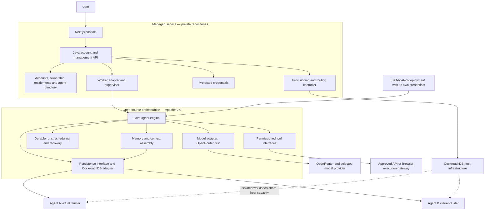

# diyalamp: persistent agents, replaceable models

Architecture proposal · 18 October 2026 · not an implementation or deployment claim.

> Your agents. Your models. Memory that stays.

An agent is a durable identity with instructions, permissions, work and memory.
It is not a model session or an always-running computer. A worker wakes it when
there is work, reconstructs relevant context, calls the selected model, performs
permitted actions, and checkpoints progress.

Changing the model preserves stored records. It does not promise identical
reasoning, tool support, private reasoning traces, or behavior.

## The language decision

**Specialize in Java. Learn enough TypeScript to understand and change the UI.**
The founder has already started Java and wants to learn databases and server-side
systems. That is a sound reason to keep it as the main language. AI-assisted
programming still requires understanding transaction boundaries, authorization,
concurrency, exceptions, resource limits, and how to investigate failures.

- Java: orchestration engine, worker pool, model adapter and persistence interfaces.
- Java/Spring Boot: the separate managed account and provisioning backend.
- TypeScript/React/Next.js: the private managed console; browser extension later
  only if explicitly selected local browser access becomes part of the product.
- HTML/CSS/JavaScript: retain the inexpensive static marketing website.

An all-TypeScript implementation would reduce language switching and is viable.
Java is a learning and engineering choice here, not a requirement imposed by AI.
Keep the existing local TypeScript fixture prototype as a reference; do not
rewrite it and call that hosted-product progress. Select a supported JDK for the
new service and pin it in CI; no preview language features are required.

## Open source and managed service are separate products



The managed backend is not the open-source engine with account checks sprinkled
through it. It supplies implementations of narrow engine interfaces and manages
the hosted service. Self-hosting must not require a diyalamp account or a callback
to a proprietary management API.

| Public Apache-2.0 engine | Private managed service |
| --- | --- |
| Agent/run state machine and worker loop | Google sign-in, sessions and hosted account ownership |
| Durable scheduling, checkpoints, leases and recovery | Hosted provisioning, placement and lifecycle operations |
| Memory contracts, context assembly and storage adapter | Multi-account routing, fleet supervision and support |
| OpenRouter model adapter and capability checks | Credential vault integration and credential brokerage |
| Tool contracts, approval binding and action reconciliation | Hosted console, billing and paid entitlements |
| Command-line runner and basic local inspection | Deployment automation, hosting and operational policy |

Public examples use synthetic records and placeholders. Production keys,
customer records, infrastructure configuration and paid-service implementation
do not go into the public repository. Existing public code remains Apache-2.0;
this proposal does not retroactively change its license.

## What the console looks like

The console is a workspace for supervising persistent agents, not a transcript
that hides execution. Use Inter, compact semibold controls, paper-like surfaces,
restrained color and purposeful motion. Every animation has a reduced-motion
equivalent and must not obscure a failure or pending approval.

1. **Agents overview:** compact rows/cards with name, responsibility, selected
   model, last activity, run state and a clearly defined spending limit. Sleeping,
   paused, waiting for approval, disconnected and failed are different states.
2. **Create agent:** name, purpose, model connection, compatible model, tool
   permissions and budget. Provisioning has a visible state; a failed database
   request must not produce an apparently working agent.
3. **Agent workspace:** left agent navigation; central Activity, Tasks and Memory
   tabs; right inspector for model, limits, permissions and storage status.
   A chat composer is a command channel inside the workspace, not the workspace.
4. **Memory:** inspect original messages, source-linked observations, user-pinned
   facts, model-proposed summaries and checkpoints. Inferred beliefs are labeled
   and revisable; a model output is not automatically a verified fact.
5. **Model switch:** show compatibility, context limits and data destination;
   apply at a turn boundary and preserve history. Do not transfer opaque
   provider-specific reasoning as if it were portable memory.
6. **Approvals:** exact operation, destination, inputs and expected consequence.
   Expire an approval when its action, relevant page or permissions change.
7. **Connections/settings:** connect or revoke OpenRouter, inspect provider usage,
   export/delete retained memory, configure retention and see hosted-plan status.

The marketing-site console is an interactive architecture illustration. Its
records are fictional, its state is local to the page, and it has no real login,
API-key input, inference, paid charge or database provisioning.

## Two data boundaries

### Shared managed control plane

Stores accounts, verified provider identities, sessions, agent ownership,
provisioning operations, endpoint routing, model-connection references and hosted
entitlements. Credentials are encrypted in protected storage; a directory record
contains a reference, never a secret that can enter a prompt.

Use immutable verified issuer/subject identity for Google sign-in, not email as a
cross-provider account-linking key. Use server-owned sessions with secure,
HttpOnly cookies, CSRF protection and server-side ownership checks. The console
cannot choose another account by sending a different account identifier.

### One agent's data environment

The target is an isolated CockroachDB virtual cluster per agent. Inside it live
the authoritative agent configuration revision, run queue, lease/fencing state,
messages, observations, memory records, checkpoints, action intents, approvals,
usage reservations, and message inbox/outbox. SQL credentials are scoped to that
environment. Memory remains when a worker sleeps.

Do not confuse a SQL database, schema or tenant-id convention with a virtual
cluster. A lower-cost development profile may use a local database or separate
logical databases, but must label that weaker isolation honestly.

**Keep a run's lease and checkpoint in the same transaction boundary.** The
shared directory can advertise work, but it is not the authoritative lock for
state committed in another virtual cluster. Cross-agent messages use a durable
sender outbox, an authorized relay and a deduplicated recipient inbox. Do not
assume a transaction spans independent virtual clusters.

## One turn through the engine

```mermaid
sequenceDiagram
  participant U as User or schedule
  participant M as Managed backend
  participant D as Agent database
  participant W as Java worker
  participant R as OpenRouter/model
  participant T as Tool gateway
  U->>M: Submit task
  M->>D: Enqueue deduplicated command
  W->>D: Claim run and fencing generation
  W->>D: Read bounded relevant memory
  W->>D: Reserve budget and persist model request identity
  W->>R: Instructions, permitted tools, selected context
  R-->>W: Proposed answer or tool operation
  W->>D: Record model result and reconcile reserved usage
  W->>D: Validate and commit action intent
  Note over W,D: Human approval where required; no external call inside retryable transaction
  W->>T: Execute authorized operation
  T-->>W: Outcome or uncertain response
  W->>D: Check lease and checkpoint result
  W-->>M: Progress event for console
```

Runs move through queued, running, waiting-for-approval, waiting-for-input, paused,
completed, failed or needs-reconciliation. State transitions are explicit, with
bounded retries and visible reasons. A process or thread is disposable; the
checkpoint is the source of continuity.

Claim leases atomically, renew within bounded deadlines, and increment a fencing
generation when ownership changes. Reject stale workers' writes. A model change
affects a later turn, not an already-approved operation halfway through execution.
The tool gateway revalidates current ownership/fence, permissions and approval
immediately before dispatch; a fenced-out worker must not retain a raw browser
connection that bypasses this gate. A request already dispatched cannot be
un-sent by fencing and may still need outcome reconciliation. Model timeouts or
worker death preserve an unknown model-request/usage record rather than silently
releasing the allowance and paying for the same request again.

Serializable transaction retries repeat **database work only**. Never put an
OpenRouter request, browser click, outbound message or payment inside a database
retry closure. Persist intent, commit, execute externally, then persist/reconcile
the outcome. A database cannot make an external action exactly once. If a worker
dies after Submit, inspect the receipt or resulting state before considering a
retry; otherwise stop for reconciliation.

## Provisioning without accidental duplicates

Persist a stable provisioning operation before calling a cloud API:

requested → creating → initializing → ready

Also retain failed, outcome-unknown, deleting and deleted states. A timeout does
not mean creation failed. Reconcile the existing operation and remote resource
before issuing another creation request. Retrying initialization uses versioned,
idempotent schema migrations. Retry/delete must respect backups, retention,
active runs, customer intent and resource ownership.

Worker credentials can connect only to the selected agent environment. Cloud
organization provisioning credentials remain with the managed provisioning
service and are never passed to an LLM or ordinary agent tool.

## Model agnostic and cloud agnostic: precise meanings

- **Model agnostic:** persist a provider-neutral conversation/tool-result format
  and select a model through an adapter. OpenRouter is the first adapter; it does
  not make all models equally capable. Require the capabilities a task needs,
  such as structured tools or vision, and do not silently switch to an
  incompatible model. Model/provider fallback respects user selection, budget
  and privacy policy.
- **Cloud agnostic by design:** package Java services as ordinary containers and
  communicate through HTTP and SQL. Avoid a required AWS/GCP/Azure-specific queue,
  scheduler, identity broker or inference runtime in the open-source engine.
  Hosted adapters can use cloud services behind interfaces. Portability remains
  a design target until tested on named environments.
- **Not database agnostic:** CockroachDB is the intended persistence backend.
  SQL protocol compatibility does not mean every Postgres feature is supported.
- **Not entirely local/private inference:** selected context is sent to
  OpenRouter and the selected provider. Durable memory is stored in CockroachDB,
  but that does not mean information never leaves it. Make routing and retention
  choices visible before a connection is authorized.

Prefer OpenRouter's S256 PKCE connection flow with one-time state verification
and server-side code exchange. Use a protected limited key as a development
fallback; never request keys in chat, commit them, render them in the marketing
demo, or store them in browser local storage. Redact authorization headers and
content-bearing logs. Revoking a connection cancels future calls, while retained
memory follows the user's chosen retention policy.

## Execution, isolation and browser scope

One bounded worker pool can serve many persistent agents. There is no JVM, VM or
browser permanently reserved for every sleeping agent. Java virtual threads can
help I/O concurrency; they do not supply durable execution and do not replace
connection, request, browser and cost limits.

Start with explicitly implemented tools. Model output is untrusted input, not
Java code to evaluate. Arbitrary agent-generated code requires a separate
restricted sandbox, with CPU/memory/time limits, explicit egress and no ambient
cloud credentials. A shared worker process is not a security sandbox.

Browser tools remain a separate capability. The user requested a ground-up
browser driver, with no Playwright/Stagehand reuse in the planned runtime; a
direct CDP adapter is the intended route. Cloud agents do not inherit the user's
local Chrome sessions. A future extension can expose explicitly allocated local
tabs, but work depending on them waits while the browser is offline. Cloud-hosted
browser sessions have their own login handoffs and cost. Do not promise both
existing local sessions and always-on cloud execution as the same capability.

The existing TypeScript prototype still uses Playwright for controlled fixture
tabs. This document does not claim that dependency has been replaced.

## Minimum spend and entitlement

Use a modular Java service and the same codebase's worker mode before introducing
microservices. Start with one region and bounded workers; use the database for
durable scheduling instead of immediately adding Kafka, Redis or another vector
database. Add indexed retrieval only after the first memory-recovery loop works.

Reserve a bounded cost allowance before dispatching a model call, cap output
tokens and steps, record actual usage, and preserve unknown costs for
reconciliation. A user key may also be used outside diyalamp, so its remaining
balance is not an exact per-agent budget ledger. Provider key limits are a second
boundary, not a replacement for platform limits. No claim of a perfect hard cap
without provider support and accounting for concurrent/unknown requests.

The hosted service needs a valid paid entitlement before it runs customer work;
OpenRouter inference is charged through the customer's connection. BYOK does not
pay diyalamp's hosting bill. Prices and checkout are not activated by this design.
Self-hosted users supply their own infrastructure and model connection.

### A material gate before provisioning

As checked on 18 October 2026, the public feature reference places hosting virtual
clusters on Mission Critical with Cluster Virtualization enabled. The pricing
page lists the virtualization add-on and says provisioned idle compute is billed.
These statements must not be replaced by a blanket "idle agents cost nothing"
claim. Check account eligibility, region, minimum allocation, preview API, quotas,
storage model and the actual estimate before creating paid resources.

If a private host is too expensive for a first prototype, stop at the
provisioning interface and honestly labeled local development isolation. Do not
silently buy an expensive host to preserve the diagram. Multi-region resilience
also needs an explicit topology and budget; it is not implied by the database
brand alone.

## First implementation milestones

1. Local Java core: agent creation, task queue, normalized memory and restart
   recovery, using an explicitly documented development persistence profile.
2. One real OpenRouter model connection and a read-only tool, with bounded calls
   and compatible model switching. Test with a synthetic account before a user.
3. Repeat the same task after restarting the worker and changing models; show
   retained records without claiming identical outputs.
4. Managed account service and private console, with ownership and connection
   revocation tests. Keep the open-source CLI independently runnable.
5. Provision one real agent virtual cluster only after entitlement/cost checks;
   test create/initialize/timeout-reconcile/pause/delete lifecycle.
6. Add action approvals and ambiguous-outcome recovery before broader browser
   permissions, autonomous code execution or public launch.

Do not implement all of this during an architecture/website task. The existing
prototype remains a separate verified slice. No new paid infrastructure, cloud
login, credential, subscription, live model call or production agent is created
by publishing this proposal.

## References and current verification

- [Spencer Kimball's Continuum announcement](https://www.cockroachlabs.com/blog/continuum-announcement/).
- [Isaac Wong's architecture explanation](https://www.cockroachlabs.com/blog/continuum-architecture/).
- [Virtualization overview](https://docs.cockroachlabs.com/docs/continuum/virtualization-overview).
- [Feature reference](https://docs.cockroachlabs.com/docs/continuum/feature-reference).
- [Current pricing](https://www.cockroachlabs.com/pricing/).
- [OpenRouter model capability API](https://openrouter.ai/docs/api/api-reference/models/get-models).
- [OpenRouter PKCE](https://openrouter.ai/docs/guides/overview/auth/oauth).
- [Google OpenID Connect](https://developers.google.com/identity/openid-connect/openid-connect).
- [CockroachDB transaction retry reference](https://docs.cockroachlabs.com/docs/stable/transaction-retry-error-reference).

The repository's [TypeScript fixture verification](../workspace/verification/local-slice.json)
describes what is actually tested today. The website and this proposal must not
expand those results into claims about cloud agents or portable model memory.

See [the learning path](LEARNING_PATH.md) for a practical route through this design.
